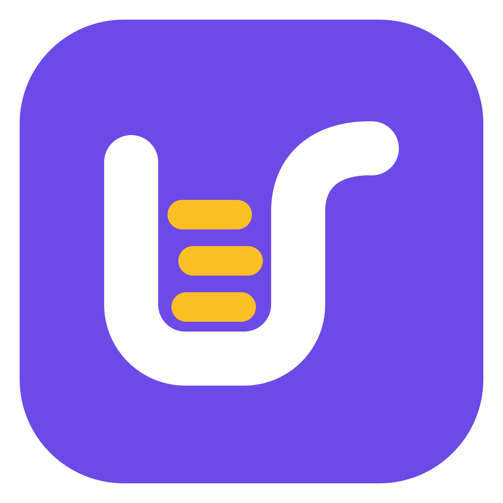
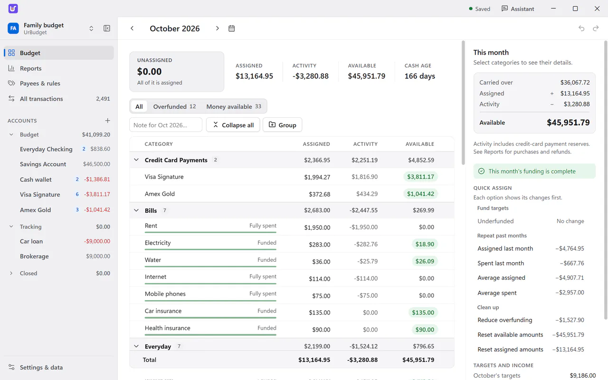

<p align="center">
  
</p>

<h1 align="center">UrBudget</h1>

<p align="center">
  <a href="https://urbudget.app">urbudget.app</a> ·
  <a href="https://urbudget.app/download/">Download for Windows and Mac</a> ·
  <a href="docs/README.md">Docs</a>
</p>

A private envelope budget for Windows, macOS, iPhone, iPad and Android. The apps are free and open
source under the [GNU AGPL v3](LICENSE); the only paid part is optional end-to-end encrypted sync
through urbudget.app, $3 a month. One Rust engine does the accounting everywhere; each app draws
its own interface.

<picture>
  <source media="(prefers-color-scheme: dark)" srcset="web/public/img/budget-dark-1280.webp">
  
</picture>

| Folder | What it is |
| --- | --- |
| [`desktop/`](desktop/README.md) | The Windows and macOS app: Tauri, with a React window |
| [`ios/`](ios/README.md) | The iPhone and iPad app: SwiftUI, an Xcode project |
| [`android/`](android/README.md) | The Android app: Kotlin and Jetpack Compose, a Gradle project |
| [`crates/`](crates/) | The shared Rust engine. [`urbudget-core`](crates/urbudget-core/) does the accounting, SQLite storage, imports, reports and sync merges; [`urbudget-services`](crates/urbudget-services/) the account, encrypted sync, sealed vault, bank and YNAB connections and the assistant. [`urbudget-ios`](crates/urbudget-ios/) and [`urbudget-android`](crates/urbudget-android/) let the phone apps call them |
| [`shared/`](shared/) | Kotlin for Android's Keystore and Google Play billing, and test fixtures |
| [`web/`](web/README.md) | The website and API at urbudget.app (one Cloudflare Worker): accounts, the sync subscription, sync storage |
| [`scripts/`](scripts/) | Repository tools, such as [`versions.mjs`](scripts/versions.mjs) for each app's version |
| [`docs/`](docs/README.md) | Guides, release status and history |

```text
desktop/   React window  -> Tauri commands ----------+
ios/       SwiftUI screens -> crates/urbudget-ios ----+--> crates/urbudget-services
android/   Compose screens -> crates/urbudget-android +    crates/urbudget-core
```

The [mobile guide](docs/MOBILE.md) explains how the phone apps build the Rust engine into
themselves and where their code is. Desktop, Android and iOS each have their own version, tag and
release workflow: see [RELEASING.md](RELEASING.md). Start with the
[documentation index](docs/README.md) for everything else.

To run the desktop app:

```sh
cd desktop
npm ci
npm run desktop
```

For the phone apps, open `ios/UrBudget.xcodeproj` in Xcode or the `android/` folder in Android
Studio and run; each README lists what to install first.

Private YNAB exports, `migration-*` fixtures and local `reports/` evidence are not application
assets or source documentation. See [artifact retention](docs/ARTIFACTS.md) before cleaning them.

## License

Copyright (C) 2026 Ahmad Horanieh.

UrBudget is free software: you can redistribute it and/or modify it under the terms of the
[GNU Affero General Public License](LICENSE) as published by the Free Software Foundation, either
version 3 of the License, or (at your option) any later version. It is distributed in the hope that
it will be useful, but WITHOUT ANY WARRANTY; without even the implied warranty of MERCHANTABILITY
or FITNESS FOR A PARTICULAR PURPOSE. Running a modified version for others over a network means
offering them its source, as the license's section 13 describes.

"UrBudget" and its icon identify the official apps and urbudget.app; forks should use their own
name.
